<p align="center">
  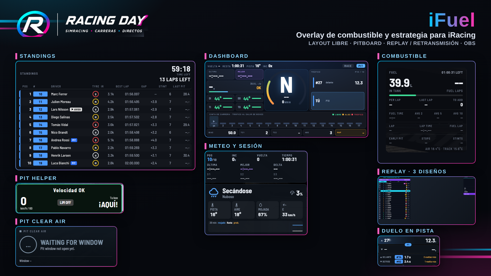
</p>

<p align="center"><a href="README.md">Español</a> · <b>English</b></p>

# iFuel · Fuel and strategy overlay for iRacing

iFuel is a Windows desktop app that reads iRacing telemetry and shows it where you need it: an **overlay** on top of the game, a **pitboard** on a second screen, a **TV-style broadcast** for your streams, and a **lap analyzer** built from your `.ibt` files. Everything runs locally: no accounts, no external services.

Made by [Racing Day](https://www.youtube.com/@RacingDaySimracing) (sim racing, races and live streams in Spanish).

> **Status: beta.** We are testing builds before the stable `v0.1.0`. Grab the latest from [Releases](https://github.com/empg80/iFuel/releases) and tell us what breaks (see [Test report](#test-report-beta)). The app interface is currently in Spanish.

---

## Contents

- [Installation](#installation)
- [Getting started](#getting-started)
- [The three layouts](#the-three-layouts)
- [Widgets](#widgets)
- [OBS and broadcast](#obs-and-broadcast)
- [Lap analysis (.ibt)](#lap-analysis-ibt)
- [Spotter](#spotter)
- [Privacy and security](#privacy-and-security)
- [Test report (beta)](#test-report-beta)
- [Development](#development)
- [Roadmap](#roadmap)
- [Credits and license](#credits-and-license)

---

## Installation

**Requirements:** 64-bit Windows 10/11 and iRacing on the same PC. You do not need Node.js or anything else.

1. Download `iFuel-<version>-win-x64.zip` from [Releases](https://github.com/empg80/iFuel/releases).
2. Extract the zip into a folder of your own (for example `C:\Programs\iFuel`).
3. Run `iFuel.exe`.

Windows may show a **SmartScreen** warning ("Windows protected your PC") because the app is not code-signed yet. Click **More info → Run anyway**. You can verify the zip with the SHA-256 published with each release.

---

## Getting started

1. Open iFuel. The main window has this menu: **Widgets · Pantalla y posición (screen and position) · Replay / retransmisión (broadcast) · Spotter · OBS: copiar URL de widget (copy widget URL) · Avanzado (advanced) · Prueba BETA (beta testing)**.
2. Start iRacing and get on track. Until data arrives, widgets show "Waiting for iRacing data…".
3. In **Pantalla y posición** pick the monitor for the overlay (normally the one where you play).
4. Press **Ctrl+Shift+L** to enter edit mode, drag the widgets where you want them, then press it again to lock them (from then on the overlay no longer gets in the way of the mouse).
5. **Ctrl+Shift+H** hides or shows the overlay. The system tray icon has the full menu.

Positions, scales and settings are saved automatically and do not change when you switch layouts.

---

## The three layouts

Switch from the main window. Each layout remembers its monitor, position and size.

### Free layout (overlay on the game)

A transparent, always-on-top, click-through window. Each widget can be moved, scaled and enabled or disabled independently. Meant for the monitor where you watch iRacing.

### Pitboard (second screen)

A 1280×800 screen meant for a small monitor or tablet next to your wheel, with four tabs:

| Tab | What it is for |
| --- | --- |
| **Estrategia** (Strategy) | Timing, flag alerts, standings by class with tyres, pit plan with a clear-air window, race rules, tyre status and car settings (BIAS, TC, ABS). |
| **Dashboard** | Full-screen steering-wheel dashboard: gear, speed, deltas, fuel, tyre temperatures, traffic and settings. |
| **Planificador** (Planner) | Plan endurance races: stints, stops, refuelling and driver changes with several drivers. |
| **Análisis** (Analysis) | Lap analysis from `.ibt` files (see [below](#lap-analysis-ibt)). |

<p align="center">
  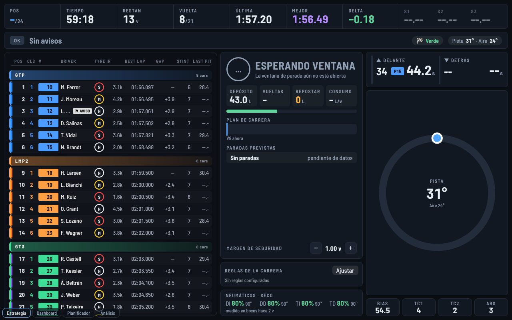
  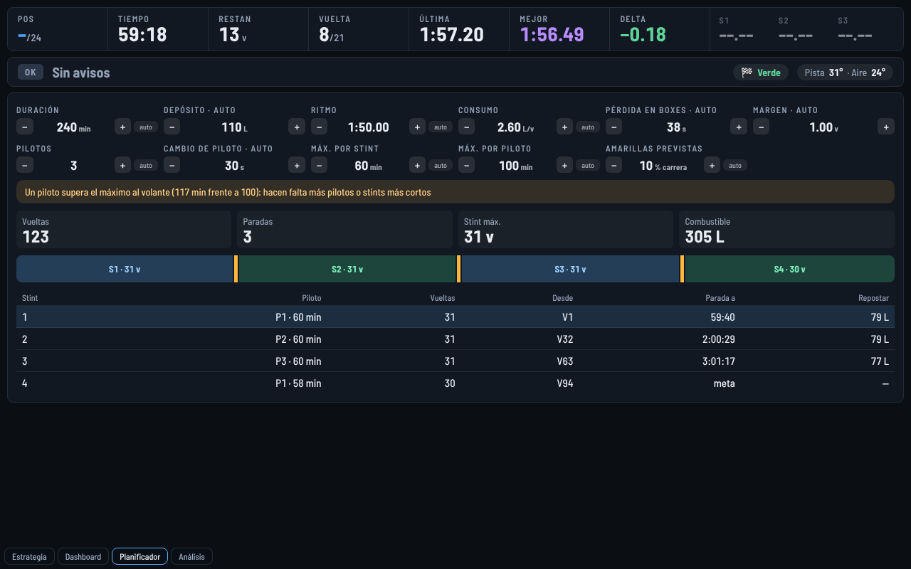
</p>

### Replay / broadcast

A window of its own with the TV-style broadcast, ideal for watching replays or capturing in OBS. It shows the standings tower (in phases, with per-class tabs), the camera driver card (speed, best and last lap, tyre and stops), circuit info and weather, and the window closes by itself when you close iFuel.

- **3 designs:** TV, Ribbon (bottom bar) and Pylon (side tower).
- **6 palettes:** Cyan, F1, Green, Orange, Mono and a custom one (background and two accents).
- **Gap** against the leader or the car ahead, optional guides and tower rotation speed.

<p align="center">
  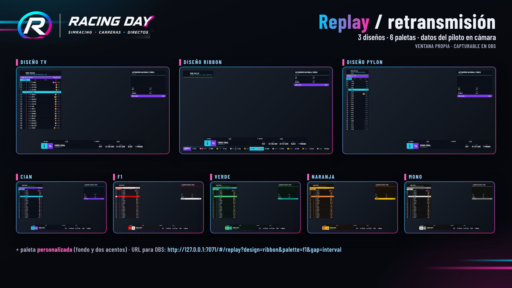
</p>

---

## Widgets

<p align="center">
  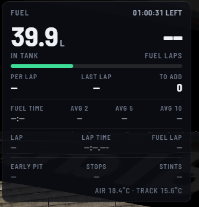
  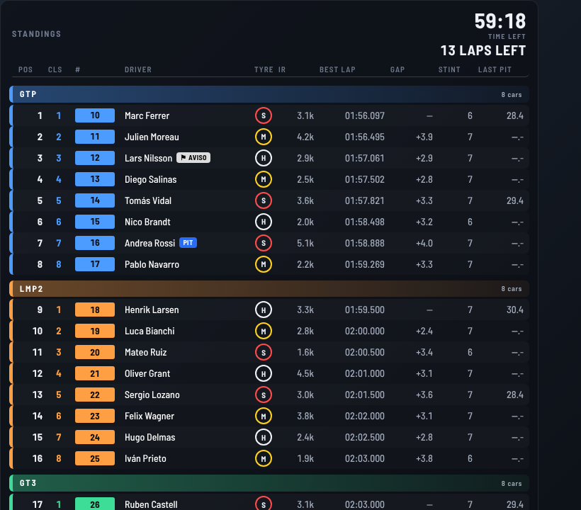
  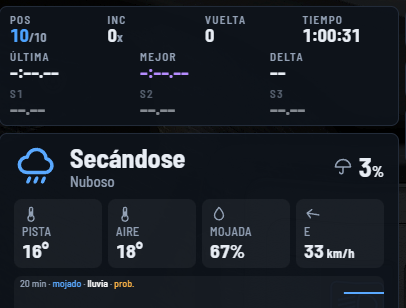
</p>

| Widget | What it shows |
| --- | --- |
| **Fuel** | Tank, fuel per lap (last and 2/5/10-lap averages), laps and time remaining, refuel needed, earliest pit (EARLY PIT), number of stops and target stints. With settings for minimum lap, minimum fuel and safety laps. A click toggles compact and full view. |
| **Standings** | Live standings by class with car number, tyre, iRating, best lap, gap, stint, last stop, and PIT, penalty and flag tags. Names as "N. Surname". Fixed width so it never jumps around. |
| **Battle / relative** | Your class position and the cars ahead and behind, in class and on track, with gaps and deltas, colour-coded by class. |
| **Yellow flag** | Track status and distance/time to the incident. |
| **Pit clear air** | Recommended pit lap based on the traffic expected at pit exit. |
| **Pit helper** | Pit speed limiter and your pit box call. |
| **Steering-wheel dashboard** | Gear, speed, delta, fuel, tyres, traffic and settings (BIAS, TC1, TC2, ABS, MAP). |
| **Fast traffic** | Warning when a faster class is catching you in multiclass races. |
| **Weather and session** | Temperatures, track wetness, wind and rain forecast, plus your position, lap and times. |
| **Tyres and car** | Tyre temperature and wear and car settings (BIAS, TC, ABS). |
| **Race rules** | Mandatory stops, minimum pit time and maximum stint, with warnings. |

<p align="center">
  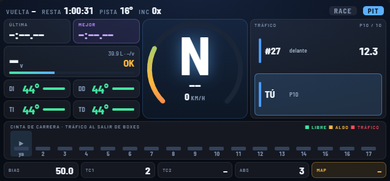
  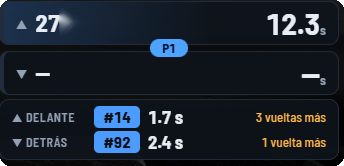
  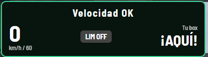
  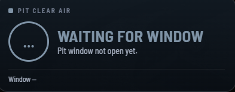
</p>

---

## OBS and broadcast

iFuel serves the app at `http://127.0.0.1:7071` and every widget has its own page with a **transparent background**, ready for an OBS *Browser Source*. The easiest way is the **"OBS: copiar URL de widget"** menu; you can also type them by hand:

| Widget | URL |
| --- | --- |
| Fuel | `http://127.0.0.1:7071/#/obs/fuel` |
| Standings | `http://127.0.0.1:7071/#/obs/standings` |
| Battle / relative | `http://127.0.0.1:7071/#/obs/relative` |
| Pit clear air | `http://127.0.0.1:7071/#/obs/pitclear` |
| Yellow flag | `http://127.0.0.1:7071/#/obs/yellow` |
| Driver, weather, car, dashboard | `…/#/obs/driver`, `…/#/obs/weather`, `…/#/obs/car`, `…/#/obs/dash` |
| Fast traffic and pit helper | `…/#/obs/traffic`, `…/#/obs/pithelper` |

**Full broadcast** (1920×1080, transparent background):

```
http://127.0.0.1:7071/#/replay?design=ribbon&palette=f1&gap=interval&guides=1&phase=10&serie=My%20League
```

| Parameter | Values |
| --- | --- |
| `design` | `tv` · `ribbon` · `pylon` |
| `palette` | `cyan` · `f1` · `green` · `orange` · `mono` · `custom` |
| `gap` | `leader` (against the leader) · `interval` (against the car ahead) |
| `guides` | `1` shows guide frames in the reserved slots (e.g. for the circuit map) · `0` hides them |
| `phase` | seconds per tower phase: `5` · `10` · `15` · `20` |
| `serie` | title text (your league or series name) |

---

## Lap analysis (.ibt)

The **Análisis** tab of the pitboard opens the `.ibt` files iRacing saves in your telemetry folder and analyzes your session:

- Detects laps by start/finish line crossing, discards non-comparable ones (pit laps, off-tracks) and computes your **ideal lap**, average and deviation.
- **Session evolution** chart and a lap table with the difference to your best.
- Compare any lap against your best: speed, brake and throttle over distance and **time lost accumulated per corner**.

<p align="center">
  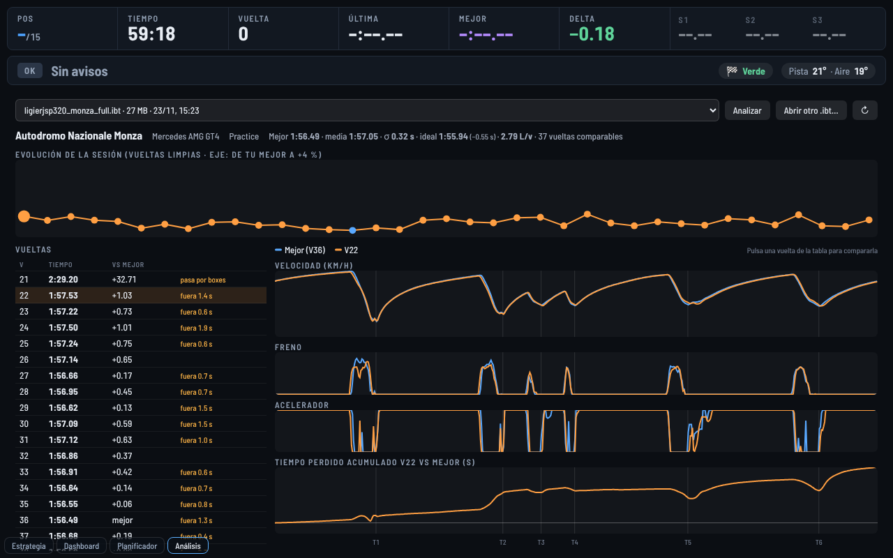
</p>

The analysis runs in a separate process so it does not affect the overlay, and it has size and time limits.

---

## Spotter

The **Spotter** menu enables voice alerts using natural pre-recorded voices in Spanish and, if one is missing, the system voice as a fallback. It warns about cars left or right and clear track, a faster class catching you, yellow flags or incidents, critical fuel, pit window, pit entry, last lap, chequered flag and rain; each alert can be turned on or off.

---

## Privacy and security

- **Everything is local.** The telemetry server listens only on `127.0.0.1:7071`; iFuel sends no data to any external service and asks for no accounts.
- Only the app itself can use its internal channels; windows cannot navigate to other pages or open new windows, and all browser permissions (camera, microphone, USB…) are denied.
- The server validates the `Host` header and sends security headers.
- Electron is packaged with its security *fuses* enabled (no `RunAsNode`, no `NODE_OPTIONS`, no inspector, loading only from `app.asar`).
- `.ibt` reading has size limits and the analysis runs with memory and time caps.
- Dependencies are checked with `npm audit`.

---

## Test report (beta)

The **Prueba BETA** menu records your session on its own and, when you close iFuel, produces a `.zip` with the recording and the log to send when reporting a problem. Before sharing it, keep in mind that the log may include paths from your PC (for example, your Windows user name).

The procedure for a test with iRacing is in [`docs/PRUEBA-REAL.md`](docs/PRUEBA-REAL.md) (Spanish) and the notes for each beta are in [`docs/PRUEBA-BETA.txt`](docs/PRUEBA-BETA.txt).

---

## Development

**Stack:** Electron 40 · React 19 · Vite · TypeScript, with a Node telemetry server (`iFuel-telemetry-node`, based on [`irsdk-node`](https://github.com/bengsfort/irsdk-node)) that publishes data over WebSocket at `ws://127.0.0.1:7071/ifuel` and serves the app over HTTP on the same port. Inside the app the server starts by itself.

```bash
git clone https://github.com/empg80/iFuel.git
cd iFuel
npm install
(cd iFuel-telemetry-node && npm install)

npm run dev             # Vite + Electron (also starts the telemetry server)
npm run lint            # code check
npm run build           # build the client
npm test                # client and server tests (no iRacing needed)
npm run electron:build  # package the app (on Windows, builds the zip with electron-builder)
```

Tests use a simulated iRacing SDK, so they run on any OS. `ANALYZE=1 npm run build` also writes `stats.html` with the bundle report.

Key files:

| Path | Contents |
| --- | --- |
| `electron/main.cjs` | Windows, layouts, tray, IPC and security. |
| `iFuel-telemetry-node/` | Telemetry server, `.ibt` analyzer, static server. |
| `src/useIfuelWebSocket.ts` | Telemetry reading, averages, strategy and pit clear air. |
| `src/FreeLayout.tsx`, `src/PitboardLayout.tsx` | Free and pitboard layouts. |
| `src/components/ReplayBroadcast.tsx` | Broadcast: tower, circuit and driver card. |
| `docs/` | Roadmap, test notes, screenshots and mockups. |

---

## Roadmap

The roadmap and per-version notes are in [`docs/ROADMAP.md`](docs/ROADMAP.md) (Spanish). Before the stable `v0.1.0` there remain, among other things, the post-start grid, analyzer extras (reference lap from another session, report export) and validating everything in real races.

---

## Credits and license

- Design and testing: **Racing Day** ([YouTube](https://www.youtube.com/@RacingDaySimracing)).
- Telemetry reading: [`irsdk-node`](https://github.com/bengsfort/irsdk-node). Fonts: [Barlow](https://github.com/jpt/barlow) and Barlow Condensed (SIL Open Font License).
- iRacing is a trademark of iRacing.com Motorsport Simulations. iFuel is an independent project and is not affiliated with iRacing.
- **License:** to be decided before the stable `v0.1.0`.
