<p align="center">
  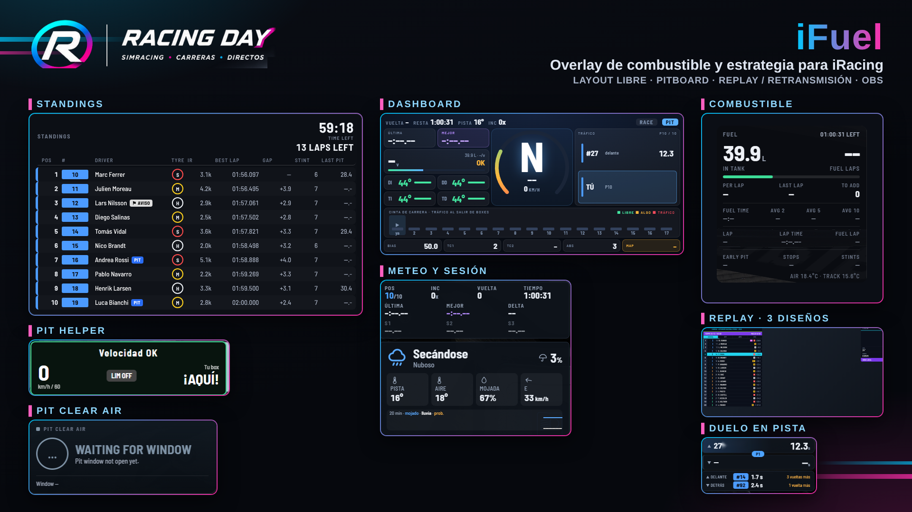
</p>

# iFuel · Overlay de combustible y estrategia para iRacing

iFuel es una aplicación de escritorio para Windows que lee la telemetría de iRacing y te la muestra donde la necesitas: un **overlay** sobre el juego, un **pitboard** en una segunda pantalla, una **retransmisión estilo TV** para tus directos y un **analizador de vueltas** a partir de tus archivos `.ibt`. Todo funciona en local: sin cuentas, sin servicios externos.

Hecho por [Racing Day](https://www.youtube.com/@RacingDaySimracing) (simracing, carreras y directos en español).

> **Estado: beta.** Estamos probando versiones antes de la `v0.1.0` estable. Descarga la última en [Releases](https://github.com/empg80/iFuel/releases) y cuéntanos qué falla (ver [Informe de pruebas](#informe-de-pruebas-beta)).

---

## Contenido

- [Instalación](#instalación)
- [Primeros pasos](#primeros-pasos)
- [Los tres layouts](#los-tres-layouts)
- [Widgets](#widgets)
- [OBS y retransmisión](#obs-y-retransmisión)
- [Análisis de vueltas (.ibt)](#análisis-de-vueltas-ibt)
- [Spotter](#spotter)
- [Privacidad y seguridad](#privacidad-y-seguridad)
- [Informe de pruebas (beta)](#informe-de-pruebas-beta)
- [Desarrollo](#desarrollo)
- [Hoja de ruta](#hoja-de-ruta)
- [Créditos y licencia](#créditos-y-licencia)

---

## Instalación

**Requisitos:** Windows 10/11 de 64 bits e iRacing en el mismo equipo. No necesitas instalar Node.js ni nada más.

1. Descarga `iFuel-<versión>-win-x64.zip` desde [Releases](https://github.com/empg80/iFuel/releases).
2. Extrae el zip en una carpeta tuya (por ejemplo `C:\Programas\iFuel`).
3. Ejecuta `iFuel.exe`.

Windows puede mostrar el aviso de **SmartScreen** («Windows protegió su PC») porque la aplicación aún no está firmada. Pulsa **Más información → Ejecutar de todos modos**. Puedes comprobar la integridad del zip con el SHA-256 que se publica en cada release.

---

## Primeros pasos

1. Abre iFuel. Verás la ventana principal con el menú: **Widgets · Pantalla y posición · Replay / retransmisión · Spotter · OBS: copiar URL de widget · Avanzado · Prueba BETA**.
2. Arranca iRacing y sal a pista. Mientras no haya datos, los widgets muestran «Waiting for iRacing data…».
3. En **Pantalla y posición** elige en qué monitor va el overlay (normalmente el del juego).
4. Pulsa **Ctrl+Shift+L** para entrar en modo edición, arrastra los widgets donde quieras y vuelve a pulsarlo para bloquearlos (a partir de ahí el overlay no estorba al ratón).
5. **Ctrl+Shift+H** oculta o muestra el overlay. El icono de la bandeja del sistema tiene el menú completo.

Las posiciones, escalas y ajustes se guardan solos y no cambian al pasar de un layout a otro.

---

## Los tres layouts

Se cambian desde la ventana principal. Cada layout recuerda su monitor, posición y tamaño.

### Layout libre (overlay sobre el juego)

Ventana transparente, siempre encima y sin capturar el ratón. Cada widget se mueve, se escala y se activa o desactiva por separado. Pensado para el monitor donde ves iRacing.

### Pitboard (segunda pantalla)

Una pantalla de 1280×800 pensada para un monitor pequeño o una tablet junto al volante, con cuatro pestañas:

| Pestaña | Para qué sirve |
| --- | --- |
| **Estrategia** | Tiempos, avisos de bandera, clasificación por clases con neumático, plan de parada con ventana de aire limpio, reglas de la carrera, estado de neumáticos y ajustes del coche (BIAS, TC, ABS). |
| **Dashboard** | Dashboard de volante a pantalla completa: marcha, velocidad, deltas, combustible, temperaturas de neumáticos, tráfico y ajustes. |
| **Planificador** | Planifica carreras endurance: stints, paradas, repostaje y cambios de piloto con varios pilotos. |
| **Análisis** | Análisis de vueltas desde archivos `.ibt` (ver [más abajo](#análisis-de-vueltas-ibt)). |

<p align="center">
  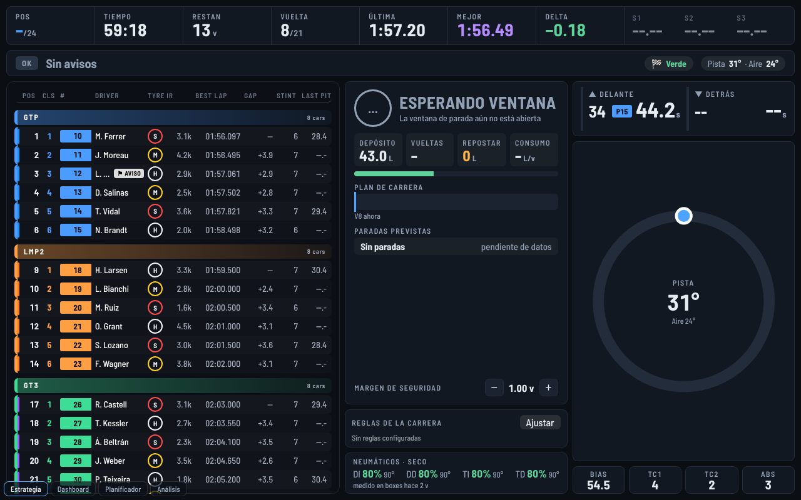
  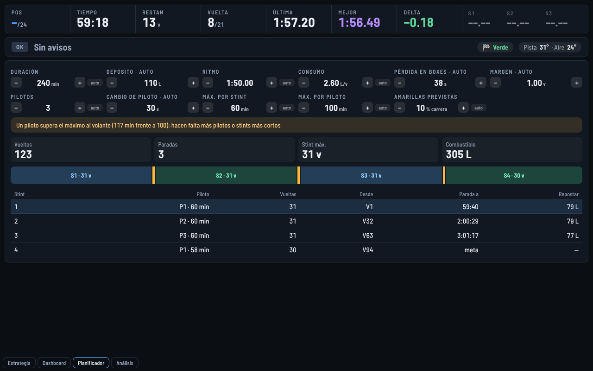
</p>

### Replay / retransmisión

Una ventana propia con la retransmisión estilo TV, ideal para ver replays o para capturarla en OBS. Muestra la torre de posiciones (por fases, con pestañas por clase), la tarjeta del piloto en cámara (velocidad, mejor y última vuelta, neumático y paradas), datos del circuito y meteo, y la ventana se cierra sola al cerrar iFuel.

- **3 diseños:** TV, Ribbon (cinta inferior) y Pylon (torre lateral).
- **6 paletas:** Cian, F1, Verde, Naranja, Mono y una personalizada (fondo y dos acentos).
- **Gap** contra el líder o contra el coche de delante, guías opcionales y velocidad de rotación de la torre.

<p align="center">
  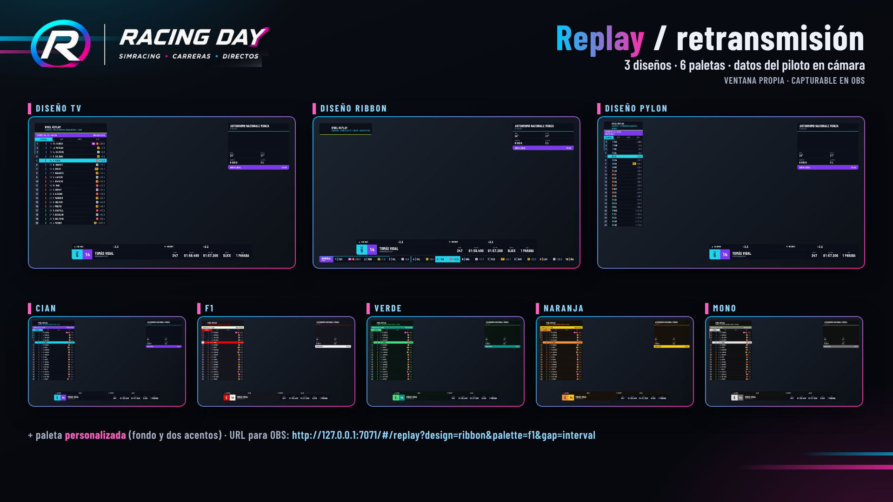
</p>

---

## Widgets

<p align="center">
  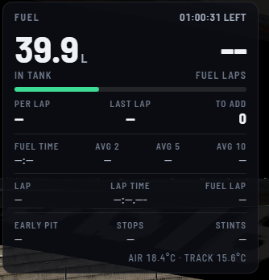
  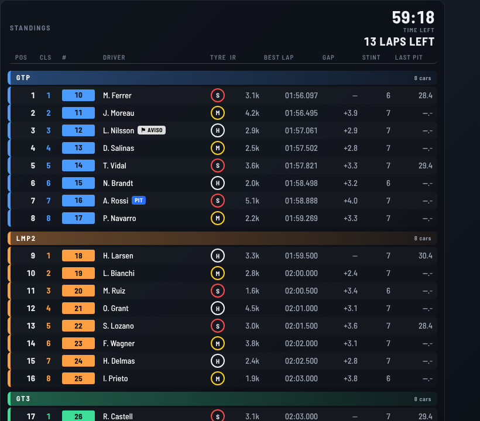
  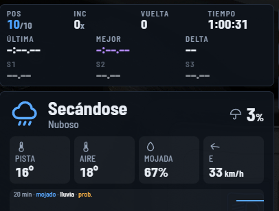
</p>

| Widget | Qué muestra |
| --- | --- |
| **Combustible** | Depósito, consumo por vuelta (última y medias de 2/5/10), vueltas y tiempo restantes, repostaje necesario, parada más temprana (EARLY PIT), número de paradas y stints objetivo. Con ajustes de vuelta mínima, consumo mínimo y vueltas de margen. Un clic alterna entre vista compacta y completa. |
| **Standings** | Clasificación en vivo por clases con número, neumático, iRating, mejor vuelta, gap, stint, última parada, y avisos de PIT, penalización y bandera. Nombres en formato «N. Apellido». Ancho fijo para que no baile. |
| **Battle / relative** | Tu posición en clase y los coches delante y detrás en clase y en pista, con huecos y deltas, con color por clase. |
| **Bandera amarilla** | Estado de pista y distancia/tiempo al incidente. |
| **Pit clear air** | Vuelta de parada recomendada según el tráfico previsto a la salida de boxes. |
| **Pit helper** | Limitador de velocidad en boxes y aviso de tu box. |
| **Dashboard de volante** | Marcha, velocidad, delta, combustible, neumáticos, tráfico y ajustes (BIAS, TC1, TC2, ABS, MAP). |
| **Tráfico rápido** | Aviso de la clase más rápida que te alcanza por detrás en carreras multiclase. |
| **Meteo y sesión** | Temperaturas, humedad de pista, viento y pronóstico de lluvia, con tu posición, vueltas y tiempos. |
| **Neumáticos y coche** | Temperatura y desgaste de los neumáticos y ajustes del coche (BIAS, TC, ABS). |
| **Reglas de la carrera** | Paradas obligatorias, tiempo mínimo en boxes y stint máximo, con avisos. |

<p align="center">
  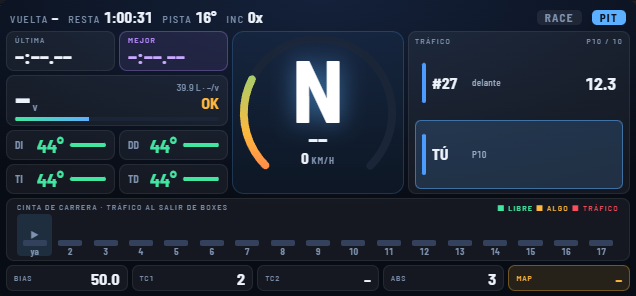
  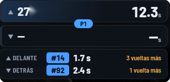
  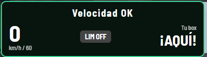
  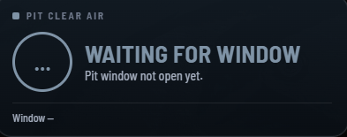
</p>

---

## OBS y retransmisión

iFuel sirve la aplicación en `http://127.0.0.1:7071` y cada widget tiene su propia página con **fondo transparente**, lista para una *Fuente de navegador* de OBS. La forma más fácil es el menú **«OBS: copiar URL de widget»**; también puedes escribirlas a mano:

| Widget | URL |
| --- | --- |
| Combustible | `http://127.0.0.1:7071/#/obs/fuel` |
| Standings | `http://127.0.0.1:7071/#/obs/standings` |
| Battle / relative | `http://127.0.0.1:7071/#/obs/relative` |
| Pit clear air | `http://127.0.0.1:7071/#/obs/pitclear` |
| Bandera amarilla | `http://127.0.0.1:7071/#/obs/yellow` |
| Piloto, meteo, coche, dashboard | `…/#/obs/driver`, `…/#/obs/weather`, `…/#/obs/car`, `…/#/obs/dash` |
| Tráfico rápido y pit helper | `…/#/obs/traffic`, `…/#/obs/pithelper` |

**Retransmisión completa** (1920×1080, fondo transparente):

```
http://127.0.0.1:7071/#/replay?design=ribbon&palette=f1&gap=interval&guides=1&phase=10&serie=Mi%20Liga
```

| Parámetro | Valores |
| --- | --- |
| `design` | `tv` · `ribbon` · `pylon` |
| `palette` | `cyan` · `f1` · `green` · `orange` · `mono` · `custom` |
| `gap` | `leader` (contra el líder) · `interval` (contra el de delante) |
| `guides` | `1` muestra marcos guía en los huecos reservados (p. ej. para el trazado del circuito) · `0` los oculta |
| `phase` | segundos por fase de la torre: `5` · `10` · `15` · `20` |
| `serie` | texto del título (nombre de tu liga o serie) |

---

## Análisis de vueltas (.ibt)

La pestaña **Análisis** del pitboard abre los archivos `.ibt` que iRacing guarda en tu carpeta de telemetría y analiza tu sesión:

- Detecta las vueltas por cruce de línea, descarta las no comparables (boxes, salidas de pista) y calcula tu **vuelta ideal**, media y desviación.
- Gráfica de **evolución de la sesión** y tabla de vueltas con diferencia contra tu mejor.
- Compara cualquier vuelta con tu mejor: velocidad, freno y acelerador sobre la distancia y **tiempo perdido acumulado por curva**.

<p align="center">
  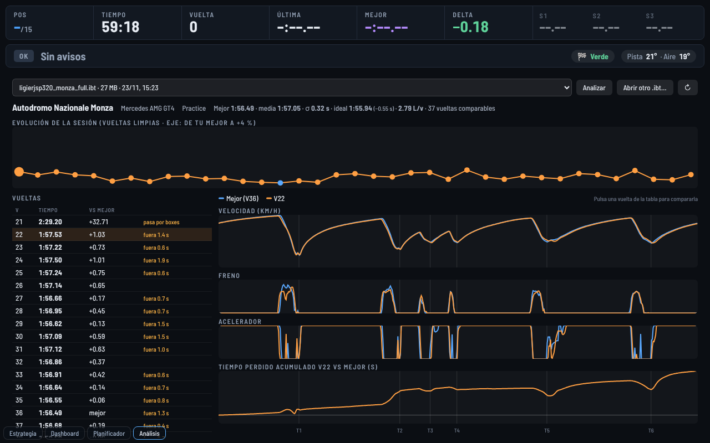
</p>

El análisis corre en un proceso aparte para no afectar al overlay y tiene límites de tamaño y de tiempo.

---

## Spotter

El menú **Spotter** activa avisos de voz con voces naturales pregrabadas en español y, si faltara alguna, la voz del sistema como respaldo. Avisa de coche a izquierda o derecha y pista libre, clase rápida que te alcanza, amarilla o incidente, combustible crítico, ventana de parada, entrada a boxes, última vuelta, bandera a cuadros y lluvia; cada aviso se puede activar o desactivar.

---

## Privacidad y seguridad

- **Todo es local.** El servidor de telemetría escucha solo en `127.0.0.1:7071`; iFuel no envía datos a ningún servicio externo ni pide cuentas.
- Solo la propia aplicación puede usar sus canales internos; las ventanas no pueden navegar a otras páginas ni abrir ventanas nuevas, y se deniegan todos los permisos del navegador (cámara, micrófono, USB…).
- El servidor valida la cabecera `Host` y envía cabeceras de seguridad.
- Electron se empaqueta con los *fuses* de seguridad activados (sin `RunAsNode`, sin `NODE_OPTIONS`, sin inspector y cargando solo desde `app.asar`).
- La lectura de `.ibt` tiene límites de tamaño y el análisis se ejecuta con tope de memoria y de tiempo.
- Las dependencias se revisan con `npm audit`.


---

## Informe de pruebas (beta)

El menú **Prueba BETA** graba sola la sesión y, al cerrar iFuel, genera un `.zip` con la grabación y el log para enviarlo al reportar un problema. Antes de compartirlo, ten en cuenta que el log puede incluir rutas de tu equipo (por ejemplo, con tu nombre de usuario de Windows).

El procedimiento para una prueba con iRacing está en [`docs/PRUEBA-REAL.md`](docs/PRUEBA-REAL.md) y las novedades de cada beta, en [`docs/PRUEBA-BETA.txt`](docs/PRUEBA-BETA.txt).

---

## Desarrollo

**Stack:** Electron 40 · React 19 · Vite · TypeScript, con un servidor de telemetría en Node (`iFuel-telemetry-node`, basado en [`irsdk-node`](https://github.com/bengsfort/irsdk-node)) que publica los datos por WebSocket en `ws://127.0.0.1:7071/ifuel` y sirve la aplicación por HTTP en el mismo puerto. Dentro de la app, el servidor arranca solo.

```bash
git clone https://github.com/empg80/iFuel.git
cd iFuel
npm install
(cd iFuel-telemetry-node && npm install)

npm run dev             # Vite + Electron (arranca también el servidor de telemetría)
npm run lint            # revisión de código
npm run build           # compila el cliente
npm test                # pruebas del cliente y del servidor (no necesitan iRacing)
npm run electron:build  # empaqueta la app (en Windows, genera el zip con electron-builder)
```

Las pruebas usan un SDK de iRacing simulado, así que funcionan en cualquier sistema. `ANALYZE=1 npm run build` genera además `stats.html` con el informe del *bundle*.

Archivos clave:

| Ruta | Contenido |
| --- | --- |
| `electron/main.cjs` | Ventanas, layouts, bandeja, IPC y seguridad. |
| `iFuel-telemetry-node/` | Servidor de telemetría, analizador `.ibt`, servidor estático. |
| `src/useIfuelWebSocket.ts` | Lectura de telemetría, medias, estrategia y pit clear air. |
| `src/FreeLayout.tsx`, `src/PitboardLayout.tsx` | Layouts libre y pitboard. |
| `src/components/ReplayBroadcast.tsx` | Retransmisión: torre, circuito y tarjeta del piloto. |
| `docs/` | Hoja de ruta, notas de pruebas, capturas y mockups. |

---

## Hoja de ruta

La hoja de ruta y las notas de cada versión están en [`docs/ROADMAP.md`](docs/ROADMAP.md). Antes de la `v0.1.0` estable quedan, entre otras cosas, la parrilla tras la salida, extras del analizador (vuelta de referencia de otra sesión, exportar el informe) y validar todo en carrera real.

---

## Créditos y licencia

- Diseño y pruebas: **Racing Day** ([YouTube](https://www.youtube.com/@RacingDaySimracing)).
- Lectura de telemetría: [`irsdk-node`](https://github.com/bengsfort/irsdk-node). Tipografías: [Barlow](https://github.com/jpt/barlow) y Barlow Condensed (SIL Open Font License).
- iRacing es una marca de iRacing.com Motorsport Simulations. iFuel es un proyecto independiente y no está afiliado a iRacing.
- **Licencia:** por definir antes de la `v0.1.0`.
